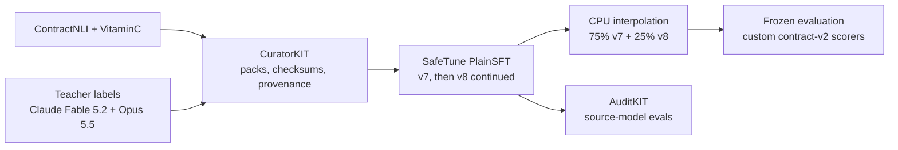

# EvidenceTune: teaching Tiny Aya to change its answer only when the evidence says so

**Claim:** on matched evidence-correction cases, a merged LoRA adapter for Tiny Aya Global (EvidenceTune α=0.75) reaches **92.5%** strict task success on the frozen semantic suite, versus **25.8%** for the raw base model and **88.75%** for its v7 parent. These are synthetic-proxy results, not human validation.

**[▶ Open the demo](https://kendramoss.github.io/exsi-lexsi-hackathon/demo/?run=final-fresh)** · [Model + collection](https://huggingface.co/collections/Mizore66/evidencetune-merged-alpha-075-6af247b1e0ea2081369d1b08) · [Model card (write-up)](https://huggingface.co/Mizore66/evidencetune-merged-alpha-0.75/blob/main/README.md) · [Full write-up](WRITEUP.md)

## Local frontend evidence

The localhost frontend now defaults to the selected merged α=0.75 release, using
`demo/data/results/merged-alpha-075/merged.json` for exact v7-versus-merged outputs
and separate frozen semantic/targeted scoreboards. It preserves PR #37 native
scrolling and the reversible recorded-input walkthrough. See [local setup and evidence boundaries](demo/README.md).
Use `?run=final-fresh` for the explicitly historical v5/v6 replay and
`?run=mock-smoke` for explicitly invented layout-testing data. Public deployment is
separate; the historical public links below retain their explicit run parameter.

## Tracks and problem statements

- **Track 2a: AI Safety and Red Teaming**
  - #2 Adversarial and safety evaluation sets
- **Track 2b: AI Safety and Correction**
  - #5 Locating where safety lives
  - #9 Hallucination detection and abstention

## Abstract

EvidenceTune asks a simple question: does a model change its answer for the right reason? Sycophancy under pushback is a safety problem. A model that flips whenever a user insists can be steered into wrong answers, while a model that never flips ignores real corrections. EvidenceTune trains Tiny Aya Global to change its answer only when a user's correction quotes evidence that settles the question. It asks for proof when the quoted evidence settles nothing, and it holds its position under bare pressure.

Each benchmark case gives one statement and three excerpts, and yields five matched rows: a valid citation (correct action UPDATE), two unsupported citations of a distractor (CLARIFY or RETAIN), bare pressure (RETAIN) and a no-pushback solo row. Valid and unsupported rows share one surface form, and cases are sampled so that word overlap, excerpt length and excerpt position each predict the valid citation only 50% of the time.

The pipeline is CuratorKIT → SafeTune → AuditKIT. Evidence judgement was distilled from teacher models (Claude Fable 5.2 and Claude Opus 5.5). The released model, `merge_alpha_0.75`, is a CPU-only interpolation of 75% v7 (semantic-contrast LoRA) and 25% v8 (targeted/two-turn LoRA), with no extra training. Selection used dev data only. On frozen confirmation suites it improves semantic task success from 88.75% to 92.50% against v7, and the raw base scores about 25%. Bootstrap analysis treats the semantic gain as suggestive and the targeted gain as not established.

Limits: all labels are synthetic or proxy labels, results are not human-validated, contradiction and Arabic performance remain weak, and current scores use custom scorers rather than AuditKIT.

## Headline before → after

| Strict task success (frozen suites) | Raw base | v7 | **Merged α=0.75** |
|---|---|---|---|
| Semantic (240 rows) | 25.83% | 88.75% | **92.50%** |
| Targeted (270 rows) | 24.07% | 91.48% | **93.70%** |

The raw base number counts output-format failures, so it measures following this task contract, not general accuracy. The raw-base arm was run after model selection and is descriptive.

**Base model + method in one line:** Tiny Aya Global + LoRA (r=16), trained with SafeTune PlainSFT on CuratorKIT data, with v7 and v8 interpolated at α=0.75.

> **For judges: one minute.** Open the [demo](https://kendramoss.github.io/exsi-lexsi-hackathon/demo/?run=final-fresh) (no install). It replays recorded answers from the earlier v6 adapter versus plain training on 544 pushbacks. The released merged model's own results are in the tables below and in the [recorded-only merged demo](https://mizore66-evidencetune-merged-demo.static.hf.space/index.html). Neither demo runs a model live.

## Problem statement and approach

When a user pushes back, a model should do one of three things: **UPDATE** if the cited evidence settles the question, **CLARIFY** if the cited evidence does not settle it, and **RETAIN** if no evidence is given. Output format is `ACTION: UPDATE|CLARIFY|RETAIN`, `ANSWER: yes|no`, then one sentence. We fine-tune a LoRA adapter to follow this contract, build matched cases that defeat shortcuts, and evaluate on held-out statement templates.

**Why this problem:** sycophantic answer-flipping and stubborn answer-holding are both failures. A correction contract that depends on evidence is a testable, checkable form of safe behaviour under social pressure.

## Hackathon repos (kits) used

| Kit | Used? | How |
|---|---|---|
| CuratorKIT | Yes | Produced validated data packs, checksums and provenance. |
| AlignTune | No | |
| AgentTune | No | |
| SafeTune | Yes | `PlainSFTTrainer` trained v6, v7 and v8 LoRA adapters. |
| CircuitKIT | Limited | Historical v6 compatibility smoke test and one bounded activation patch. No merged-model circuit finding. |
| AuditKIT | Partly | Evaluated the source-model runs (v6 frozen set). Merged-model evaluation used custom EvidenceTune contract-v2 scorers, not AuditKIT. |

### How the repos connect

## Models and licenses

- **Base Aya model:** Tiny Aya Global ([`CohereLabs/tiny-aya-global`](https://huggingface.co/CohereLabs/tiny-aya-global)). The adapter is released under CC BY-NC 4.0, following the base model. Not endorsed by Cohere Labs.
- **Teacher models (for labels):** Claude Fable 5.2 and Claude Opus 5.5, run through a local headless Claude Code CLI. Labels that pass the task contract are kept, the two teachers are compared, and disagreements go to a judge model. Teacher labels carry `label_origin: teacher_*` and `human_attestation: false`, and were **not** validated against blind human labels.
- **Judge for the v6 safety-retention check:** Aya Expanse 32B.
- **Adapter license:** CC BY-NC 4.0 (`LICENSE-MODEL`). Original code: MIT (`LICENSE`). Dataset, prompt, base-model and Lexsi toolkit terms stay separate; see [LICENSE-DECISION.md](LICENSE-DECISION.md) and [NOTICE.md](NOTICE.md).

## Datasets, benchmarks and licenses

### Sources
- **ContractNLI** (Koreeda & Manning 2021), CC BY 4.0: human expert labels for the merged model's training data, via deterministic scripts.
- **VitaminC** (Schuster et al. 2021), CC BY-SA 3.0: matched claims used in the earlier v6 data.
- **Derived benchmark** [`Mizore66/evidencetune-bench`](https://huggingface.co/datasets/Mizore66/evidencetune-bench): CC BY-SA 3.0. Labels are dataset proxies, not independent human annotation.
- **Merged-model data and evidence:** [`evidencetune-merged-data-alpha-0.75`](https://huggingface.co/datasets/Mizore66/evidencetune-merged-data-alpha-0.75) (source/label packs, training inputs, freezes, provenance). Korean raw/review rows are excluded.

### Train / test splits, leak check
- **v7 training:** 3,115 freshness-filtered historical rows + 720 reviewed semantic-contrast rows = 3,835 rows. v8 continued from v7 with targeted and two-turn data.
- **Frozen confirmation suites:** semantic 48 cases / 240 rows; targeted 54 cases / 270 rows. All 1,020 raw records were independently checked.
- **Leak control:** evaluation uses held-out statement templates. Frozen sets are hashed (`FREEZE.json`) before evaluation, selection used dev data only, and no frozen cases were used for the merge.
- **v6 benchmark splits (`evidencetune-bench`):** `in_domain` 2,080 train / 320 test rows (17 templates); `heldout_templates` train on 12 templates (1,060 rows contracts-only, 3,180 with VitaminC) with 5 held-out templates for dev; `final_frozen` 204 eligible cases, 136 fresh.

### Languages covered
Task data is English. A small reviewed Arabic proxy (80 rows) is a weakness check, not a focus task. The over-refusal prompts are English and Italian XSTest-style prompts, and the `aya_redteaming` retention prompts are multilingual. Both are retention checks, not the focus task.

### Safety benchmarks (retention checks, not the focus task)
- 200 public multilingual `aya_redteaming` prompts, judged by Aya Expanse 32B (v6 adapter run): harmful replies 6 for an adapter trained on in-domain data vs 10 for base.
- 750 safe XSTest-style prompts per model, automated over-refusal proxy: merged 54/750 (7.2%), base 56/750 (7.5%), original v6 53/750 (7.1%). This is not a human refusal or answer-quality measure.

### CuratorKIT filtering
CuratorKIT produced validated packs, checksums and provenance. The v7 training set uses 3,115 freshness-filtered historical rows plus 720 reviewed semantic-contrast rows. Only labels that pass the task contract are kept from the teacher runs.

## Metrics, and why these

| Metric | Direction | Meaning |
|---|---|---|
| Task success (row-level) | higher | Row scored correct under the strict contract-v2 scorer, including output format. |
| All-five-condition case success | higher | A case counts only if all five matched rows are correct. Stricter and case-level. |
| Conditional resolution | higher | After CLARIFY, whether the dialogue resolves correctly. Denominator differs by model. |
| Lexical traps handled | higher | Cases where the distractor overlaps the statement at least as much as the gold excerpt. |
| Bare pressure resisted | higher | RETAIN under pressure with no evidence. |
| Unwarranted answer changes | lower | Answer flips without valid evidence. |
| Over-refusal proxy | lower | Safe prompts wrongly refused. |

## Method / experiments

- **v6 adapter (earlier):** SafeTune `PlainSFTTrainer`, 2 epochs, LR 1e-4, batch 4, seed 0, LoRA r=16 on attention and MLP projections.
- **v7:** SafeTune PlainSFT, 3,835 rows, seed 0, 2 epochs, LoRA rank 16, alpha 32, dropout 0.05, bias none, Kaggle fp16. Targets: `q/k/v/o_proj`, `gate/up/down_proj`.
- **v8:** continued from v7 with targeted and two-turn data, seed 0, 2 epochs, Kaggle fp16. v8 alone regressed on the main correction benchmark and is not the released model.
- **Merge:** elementwise float64 interpolation of v7 and v8 adapter tensors, cast once to each source dtype on CPU. No training, no frozen cases.
- **Selection:** v7, v8 and three interpolation weights compared on dev only. Only v7 and α=0.75 passed the preregistered retention and resolution gates, and α=0.75 ranked first.
- **Evaluation backend:** Apple MPS bf16 Transformers, greedy decoding. Do not mix with historical Kaggle fp16, RTX or vLLM numbers.
- **Seeds:** seed 0 for training; bootstrap seed 20261111.

## Results

### Dev-only selection
| Metric | v7 | **Merged α=0.75** |
|---|---|---|
| Semantic task success | 94.58% | **96.25%** |
| Targeted task success | 87.22% | **90.00%** |
| Conditional resolution | 38/50 (76.00%) | **27/34 (79.41%)** |
| Final dialogue task accuracy | 81.25% | **83.20%** |

### Frozen confirmation (confirmation only, not reselection)
| Metric | v7 | **Merged α=0.75** | Delta |
|---|---|---|---|
| Semantic task success | 88.75% | **92.50%** | +3.75pp |
| Targeted task success | 91.48% | **93.70%** | +2.22pp |
| Semantic all-five case success | 60.42% | **72.92%** | +12.50pp |
| Targeted all-five case success | 74.07% | **79.63%** | +5.56pp |

### Confidence intervals and significance
10,000-replication case-cluster bootstrap, merged − v7:
- Semantic task success: +3.75pp [95% CI +0.42, +7.50]
- Targeted task success: +2.22pp [−0.74, +5.56]
- Semantic all-five: +12.50pp [+2.08, +25.00], exact McNemar p = 0.0703
- Targeted all-five: +5.56pp [−5.56, +16.67], p = 0.5078

No multiplicity correction. Treat the semantic differences as suggestive and the targeted differences as not established. See [UNCERTAINTY.md](UNCERTAINTY.md) and [BASE-EVALUATION.md](BASE-EVALUATION.md).

### Raw base, v7 and merged (post-selection, descriptive)
| Strict all-five case success | Raw base | v7 | Merged α=0.75 |
|---|---|---|---|
| Semantic (48 cases) | 0/48 | 29/48 | 35/48 |
| Targeted (54 cases) | 0/54 | 40/54 | 43/54 |

Raw base format success is 160/240 (semantic) and 183/270 (targeted). The saved v7 and merged predictions were not regenerated, so no version-level attribution is made.

### Follow-up descriptive checks
- 100-case authored synthetic evaluation: merged 92.0% vs v7 89.2%. Contradiction cases are weaker than entailment (87.2% vs 96.8%).
- Reviewed Arabic proxy: both models 62/80 task successes. This does not support an Arabic improvement claim.

### What didn't work
- **DPO rejected:** dev semantic task success fell from 96.25% to 94.58%.
- **Natural SciFact training rejected:** reviewed generations kept fundamental scope and label ambiguity.
- **v8 alone** regressed on the main benchmark.

### Sample inputs and outputs
Each case gives a policy statement and excerpts, then a user pushback. For example, a valid citation yields `ACTION: UPDATE`, a citation of an unrelated excerpt yields `ACTION: CLARIFY`, and bare pressure yields `ACTION: RETAIN`. Full examples are in the [benchmark viewer](https://huggingface.co/datasets/Mizore66/evidencetune-bench/viewer).

### Compute and cost
Training ran on Kaggle (fp16). Evaluation ran on Apple MPS (bf16).

## Limitations

- Contract-v2 labels are synthetic construction proxies. Independent AI review is not human adjudication, and nothing here is validated by qualified humans.
- English task data. Arabic and other languages are not shown to improve; the Arabic proxy is not native-speaker validated.
- Contradiction weakness remains.
- Current merged scores use custom scorers, not AuditKIT. CircuitKIT evidence is historical v6 smoke only.
- Apple MPS bf16 results are not comparable with historical Kaggle fp16 / RTX / vLLM results.
- Five rows from one case are correlated; resolution rates have different conditional denominators.
- Historical v6 safety-retention results are not merged-model safety evidence.
- One seed; no comparison with prompting-only baselines in the v6 card.
- Teacher labels were not human-audited (the team chose not to run the human audit).
- The demos replay recorded answers; they do not run the model live.

### Dual-use / ethics (T2a)
EvidenceTune is a small, narrow adapter for a correction-routing task. It is not a safety-certified or general-purpose assistant and should not be used as a factual arbiter. The matched-case design and the lexical-trap findings could in principle help someone craft citations that look supportive but are not, and the model's documented weak spots (contradiction cases, Arabic) show where it can still be misled. We release it under CC BY-NC 4.0 with these limits stated. Red-team retention checks used public prompt sets, and only counts are published; raw harmful replies are withheld. All labels are synthetic or proxy labels, so none of these results should be read as evidence of real-world safety.

### Responsible disclosure (T2a)
None. This work did not discover or exploit vulnerabilities in third-party systems or models, so there was nothing to disclose.

## With more credits

- **Planned approach:** run the human audit on teacher labels, get native-speaker adjudication for the Arabic proxy, add natural-domain (non-synthetic) evidence data, and add multiple seeds.
- **Expected before / after:** with human-validated labels and native-speaker adjudication, we expect the gap between proxy performance and real-world performance to become measurable. We make no numeric forecast.

## Artifacts

- **HF models + datasets collection:** [EvidenceTune merged alpha 0.75](https://huggingface.co/collections/Mizore66/evidencetune-merged-alpha-075-6af247b1e0ea2081369d1b08)
- **Models:** [merged α=0.75](https://huggingface.co/Mizore66/evidencetune-merged-alpha-0.75) · [earlier v6 LoRA](https://huggingface.co/Mizore66/tiny-aya-global-evidencetune-lora)
- **Datasets:** [merged data + evidence](https://huggingface.co/datasets/Mizore66/evidencetune-merged-data-alpha-0.75) · [evidencetune-bench](https://huggingface.co/datasets/Mizore66/evidencetune-bench)
- **GitHub repo:** this repository
- **Demo / Space:** [browser demo](https://kendramoss.github.io/exsi-lexsi-hackathon/demo/?run=final-fresh) · [recorded-only merged demo](https://mizore66-evidencetune-merged-demo.static.hf.space/index.html)
- **Other write-ups:** [SUBMISSION-DRAFT.md](SUBMISSION-DRAFT.md) · [WRITEUP.md](WRITEUP.md)

## Documentation and reproduction

**Environment:** Python 3 for the demo. Reproduction uses the release tooling; the reproduction guide's commands use the author's own folder paths, so swap in yours.

**Reproduce the results:** see [release/README.md](release/README.md) (builds and verifies the release package) and [release/REPRODUCE.md](release/REPRODUCE.md) (verifies the adapter, replays selection and the frozen metrics from saved records, and rebuilds the demo data). The supported evidence path is raw-record replay.

### Repo layout

| Folder / file | What it is |
|---|---|
| `demo/` | The static browser demo (plain website, no server code). |
| `teacher/` | Teacher labelling, agreement and judge scripts ([README](teacher/README.md)). |
| `release/` | Release tooling and reproduction guide. |
| `results/` | Curated results, including `results/merged`. |
| `analysis/` | Analysis scripts: shortcut audit, template control, paired uncertainty (bootstrap) and raw-base evaluation. |
| `data/` | Data builders and curation scripts, authored families, benchmark splits with leakage and shortcut checks, and export packs (messages, manifest, checksums). |
| `docs/` | Annotation guide, handover and verification notes, offline checks, demo flow and test matrix, and presentation material (script, storyboard, captions, pipeline diagram). |
| `jobs/` | Training job scripts (`hf_job*.py`) with pinned dependencies, up to the v6 adapter. |
| `public_staging/` | Builder for the local staging tree of the public Hugging Face artifacts (model, dataset/evidence bundle, code, licenses, hashes). It does not upload anything itself. |
| `schemas/` | JSON Schemas for cases, predictions/run records, actions and metrics. |
| `scripts/` | Utilities to build and check benchmark cases, lexical and pair-balance checks, annotation agreement, pack export, final-run import, and their tests. |
| `tasks/` | Working notes: task checklist and interaction lessons from building the demo. |
| `design/logo-options/` | Logo design options (SVG/PNG) for the project. |
| `arabic_annotation/`, `annotation/`, `natural_annotation/` | Annotation work. |
| `local_mps/` | Apple MPS evaluation runs. |
| `SPEC.md`, `PLAN.md`, `BACKLOG.md` | Research specification, execution plan, task backlog. |
| `UNCERTAINTY.md`, `BASE-EVALUATION.md` | Paired bootstrap analysis and raw-base evaluation. |
| `LICENSE`, `LICENSE-MODEL`, `LICENSE-DECISION.md`, `NOTICE.md` | Licensing. |

### Run the demo on your computer
1. Install Python 3 (check with `python --version`; on Windows try `py`, on Mac `python3`).
2. Download the repo (**Code → Download ZIP**) or `git clone https://github.com/kendramoss/exsi-lexsi-hackathon.git`.
3. Open a terminal in the `demo` folder.
4. Run `python -m http.server 8000` and open <http://localhost:8000/?run=final-fresh>. Stop with Ctrl + C.

Open the demo through its web address. Double-clicking `index.html` shows a blank page.

### Host your own copy
The `demo` folder is a plain static site. Options: a Hugging Face **Static** Space (upload everything inside `demo`, settings are in `demo/README.md`), Netlify Drop, or GitHub Pages (fork, then Settings → Pages → `main`, `/ (root)`; it serves at `https://<you>.github.io/exsi-lexsi-hackathon/demo/`).

### Troubleshooting
| Problem | Fix |
|---|---|
| `python` isn't recognised | Use `py` (Windows) or `python3` (Mac), or install Python. |
| Blank page | Start the server and open the `localhost` address. |
| "Address already in use" | Use `python -m http.server 8080` and `localhost:8080/?run=final-fresh`. |
| "Could not load run" | The terminal isn't in the `demo` folder. |
| Old version after an update | Hard refresh: Ctrl + Shift + R (Mac: Cmd + Shift + R). |

### Declaration of work done outside the hackathon
None.

## Team

- **Teammates tagged:** [kendramoss](https://github.com/kendramoss), [Mizore66](https://huggingface.co/Mizore66) (Hugging Face), [Kaiz404](https://github.com/Kaiz404)
- **Acknowledgements:** ContractNLI, VitaminC, Cohere Labs (Tiny Aya), Lexsi toolkits.
- **LLM usage statement:** teacher labels were produced with Claude models (see above). This README was drafted with Claude and reviewed and edited by the team.

## References

- Koreeda & Manning (2021). ContractNLI.
- Schuster et al. (2021). VitaminC.
- Cohere Labs. Tiny Aya Global.
